# Awesome-Automated-Document-Publishing 📚✨

  

  
  
  
  
  
  

## 🌟 Top Automated Document Publishing Ecosystem

> **A curated collection of enterprise SaaS platforms and high-performance open-source engines for server-based layout composition, data-driven publishing pipelines, and self-hosted document automation.**

**Last updated: October 2026** 📅

This directory tracks top-tier **cloud SaaS platforms** and **open-source developer tools** powering **Automated Document Publishing** (web-to-print, variable data publishing, dynamic document generation, and single-source multichannel authoring). These systems empower engineering and publishing teams to assemble high-volume publications—product catalogs, magazines, compliance dossiers, financial prospectuses, and structured technical docs—by automating typography, multi-page flows, and layout composition via APIs and CI/CD pipelines instead of manual page assembly. 🚀

---

## 📑 Table of Contents

- [📊 Sector Overview & Market Dynamics](#-sector-overview--market-dynamics)
- [☁️ SaaS & Hosted Platforms](#️-saas--hosted-platforms)
- [🛠️ Open-Source GitHub Projects](#️-open-source-github-projects)
- [🤝 How to Contribute](#-how-to-contribute)
- [💖 Support & Sponsorship](#-support--sponsorship)
- [📈 Star History](#-star-history)
- [⚖️ Disclaimer](#️-disclaimer)

---

## 📊 Sector Overview & Market Dynamics

The global automated document publishing and document generation market is valued at approximately **$4.4B to $4.7B in 2026** (scaling past $17B+ when accounting for broader enterprise intelligent document automation and IDP suites), expanding at a 9.2%–9.5% CAGR. 📈

The sector is **moderately fragmented**: core layout rendering and desktop composition pipelines remain heavily concentrated around Adobe's foundational engines (InDesign / InDesign Server), while multichannel database publishing, dynamic templating, and enterprise CCMS workflows are distributed across specialized mid-market suites and emerging cloud/open-source automation tools. 🔄

---

## ☁️ SaaS & Hosted Platforms

| Product | Scale (Revenue / Valuation) | Description | Pricing | Free Tier Limit |
| :--- | :--- | :--- | :--- | :--- |
| **[Adobe InDesign Server](https://www.adobe.com/products/indesignserver.html)** | **~$25.9B revenue / ~$100B market cap** (Adobe Inc.) | Server-based layout automation engine for high-volume, data-driven publishing. | Starts at **$2,100/year** (Development edition); Limited edition at **$5,000/year**; Premium at **$13,500/year**. | **90-day free trial** for development & evaluation via prerelease/sales; watermarked output, no permanent free tier. |
| **[Quark Publishing Platform](https://www.quark.com/)** | **~$68M estimated revenue** (Quark Software Inc.) | Modular, metadata-driven omnichannel publishing with SaaS, private cloud, and multi-tenant options. | Enterprise deployment custom quote (standalone modules like Docurated start at **$216/user/year** with 5-user min, QuarkXPress at **$279/year**). | **No free tier or public self-serve trial**; guided sales demo available on request. |
| **[WoodWing Studio](https://www.woodwing.com/)** | **~€70M+ combined group revenue** (WoodWing / Omnidocs Group) | Content creation and workflow platform for publishers, agencies, and marketing teams. | Starter tier listed from **$99/month/user** (minimum contract terms apply); Advanced & Ultimate tiers via sales consultation. | **No permanent free tier and no self-serve trial**; customized proof-of-concept demo available upon request. |
| **[CHILI Publish](https://www.chili-publish.com/)** | **~$7M–$8M ARR / ~€20M funding** (CHILI publish / GraFx) | Cloud-based document automation and templating platform for marketing collateral and catalogs. | Starts at **$875/month** (Launch tier); Transform tier at **$2,150/month**; Scale tier at **$6,550/month**. | **14-day free trial** of live GraFx discovery environment with full Design Systems access; no permanent free tier. |
| **[Typefi Publish](https://www.typefi.com/)** | **~$6.9M estimated revenue** (Typefi Systems) | Automated XML-based publishing built on Adobe InDesign Server, for single-source multi-format output. | Typefi Cloud Teams starts at **$999/month** (up to 1,000 pages/month and 2 users); Enterprise tier quote-based. | **No permanent free tier**; 14-to-30-day scoped trial or guided pilot via sales evaluation. |
| **[priint:suite](https://www.priint.com/)** | **~$5.5M estimated ARR** (WERK II / priint Group) | Publishing automation suite integrating with InDesign for catalogs, labels, and packaging. | Modular enterprise deployment from **€4,640 entry package / starting base license**; ongoing support and connectors quoted per project. | **No free tier or public trial**; live interactive sandbox demo provided upon sales qualification. |
| **[vjoon K4](https://www.vjoon.com/)** | **~$2.4M estimated ARR** (vjoon GmbH) | Publishing system tightly integrated with Adobe InDesign/InCopy for magazine and corporate publishing. | Enterprise license from **$99/month/seat** base directory rate (cloud hosting & integration packages custom quoted). | **No free tier and no free trial** available per vendor policy; scheduled demo only. |

---

## 🛠️ Open-Source GitHub Projects

Sorted in descending order by GitHub stargazers count:

- **[Typst](https://github.com/typst/typst)**   
  **A new markup-based typesetting system that is powerful and easy to learn.** Written in Rust. Delivers instantaneous incremental compilation, expressive scripting, built-in layout functions, and high-quality mathematical typesetting. An exceptional, modern alternative to LaTeX for programmatic PDF publishing and report generation. ⚡

- **[Pandoc](https://github.com/jgm/pandoc)**   
  **The universal document converter.** Written in Haskell. Converts between Markdown, HTML, LaTeX, DocBook, EPUB, PDF, and dozens of other formats. Operates as the headless content processing and AST transformation spine behind modern publishing toolchains. 🌐

- **[Marp](https://github.com/marp-team/marp)**   
  **Markdown Presentation Ecosystem.** Converts plain Markdown into slide decks, multi-page PDFs, and HTML documents using CSS themes. Features headless CLI automation (`@marp-team/marp-cli`) for CI/CD document rendering. 📽️

- **[PDFKit](https://github.com/foliojs/pdfkit)**   
  **A JavaScript PDF generation library for Node and the browser.** Provides low-level vector graphics, text layout with line wrapping, font embedding, image embedding, and complex multi-page document creation programmatically via code. 📄

- **[WeasyPrint](https://github.com/Kozea/WeasyPrint)**   
  **The HTML/CSS-to-PDF rendering engine.** Implements web standards and CSS Paged Media module specifications (page breaks, page numbers, margins, headers/footers) to produce print-ready PDFs without requiring a headless browser. 🖨️

- **[Asciidoctor](https://github.com/asciidoctor/asciidoctor)**   
  **A fast, open-source text processor and publishing toolchain for AsciiDoc.** Translates structured content into HTML5, DocBook, and PDF (via Asciidoctor PDF). Ideal for technical books, multi-chapter manuals, and API documentation suites. 📖

- **[DesignCraft](https://github.com/storytold/designcraft)**   
  **The clean-room InDesign alternative written in Rust.** **MIT OR Apache-2.0** licensed. Provides a complete page-layout interface with spreads, text frames, parent pages, layers, and typographic controls. **Key differentiator**: native **IDML import and export** interoperability plus an integrated **Model Context Protocol (MCP) server** and JSON CLI—enabling AI agents to automate and compose publication layouts programmatically. 🎨🤖

- **[Pressbooks](https://github.com/pressbooks/pressbooks)**   
  **Open-source book publishing content management platform.** Built on top of WordPress multisite, allowing educational institutions and publishers to author, manage, and export books to EPUB, MOBI, and print-ready PDF formats. 📚

- **[DITA Open Toolkit (DITA-OT)](https://github.com/dita-ot/dita-ot)**   
  **Open-source publishing engine for Darwin Information Typing Architecture (DITA) content.** Transforms XML topic-based documentation into PDF, HTML5, Eclipse Help, and JavaHelp for enterprise technical publishing. ⚙️

### 🧩 Specialized Workflow & Rendering Primitives

- **[Paged.js](https://gitlab.coko.foundation/pagedjs/pagedjs)** — Open-source library that polyfills W3C CSS Paged Media specifications, enabling browser-based print layout with running headers, crop marks, and footnotes.
- **[DocPress](https://pypi.org/project/docpress/)** — DocBook-based documentation publishing CLI using docbook-xslTNG and WeasyPrint for structured technical document workflows.
- **[imprenta](https://pypi.org/project/imprenta/)** — Markdown-to-product content arranger rendering PDF and EPUB catalogs via Pandoc and Paged.js.
- **[pycip4](https://pypi.org/project/pycip4/)** — Modern Python CIP4 library for JDF, JMF, and XJDF print-shop workflow automation.

---

## 🤝 How to Contribute

Contributions are welcome! 🎉

1. 🍴 Fork the repository.
2. 🌿 Create a new feature branch (`git checkout -b feature/awesome-addition`).
3. 📝 Add or edit entries in `README.md` (keep descriptions factual, concise, and include official links).
4. 💾 Commit your changes (`git commit -m 'Add new document publishing platform'`).
5. 🚀 Push to the branch (`git push origin feature/awesome-addition`).
6. 📬 Open a Pull Request with a clear description of the project.

---

## 💖 Support & Sponsorship

Thank you for exploring and using this collection! If you find this curated ecosystem helpful for your automated publishing, printing pipelines, or developer workflows:

- ⭐ **Star this repository** to show your appreciation and help other developers discover it!
- 🍴 **Fork and share** the project with your colleagues and network.
- ☕ **Buy a coffee & support ongoing maintenance:** Visit the [Sponsor Dashboard on GitHub Sponsors](https://github.com/sponsors/ishandutta2007) to help support further open-source research and ecosystem updates!

---

## 📈 Star History

---

## ⚖️ Disclaimer

- This is a **community-curated** list — not exhaustive and not an endorsement.
- **Commercial publishing platforms are quote-only and enterprise-priced**: Adobe InDesign Server starts at **$13,500/year** for the Premium tier; CHILI Publish ranges **$875–$6,550/month**; vjoon K4 offers no public trial and requires sales engagement. Open-source alternatives eliminate software seat licensing commitments.
- **DesignCraft is pre-alpha**: despite its impressive scope (IDML import/export, MCP server, cross-platform), it is under active development toward production InDesign parity. It represents a uniquely promising path toward an open InDesign alternative.
- **"Automated publishing" spans multiple layers**: choose Typst or Pandoc for technical docs, WeasyPrint or Paged.js for CSS-paged HTML, PDFKit for programmatic canvas layout, and DesignCraft for visual/IDML-compatible typography automation.

---

  <b>Made with ❤️ for publishing technologists, documentation engineers, and organizations automating high-volume document production.</b>

